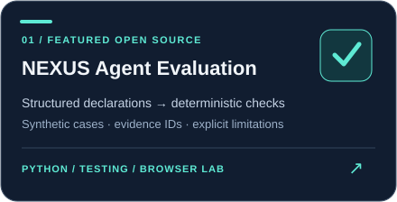

  

<h3 align="center">Technology student · Aspiring AI engineer · Open-source contributor</h3>

  <a href="https://yusyer174.github.io/Nexus-Agent-Evaluation/"><b>Live Evaluation Lab</b></a> ·
  <a href="#projects">Projects</a> ·
  <a href="#collaboration">Collaboration</a>

I'm building my foundations in computer science through Python, machine learning and open-source AI evaluation. My interests are reliable software, reproducible experiments and tools that make AI-system behavior easier to evaluate.

## Projects

<table>
<tr>
<td width="50%"></td>
<td width="50%"></td>
</tr>
</table>

### [NEXUS Agent Evaluation](https://github.com/Yusyer174/Nexus-Agent-Evaluation)

A dependency-free Python evaluator for checking declared agent decisions, requested actions and evidence identifiers against explicit test cases. The interactive lab runs on synthetic inputs, without installation or API keys.

**[Try the demo](https://yusyer174.github.io/Nexus-Agent-Evaluation/) · [CLI quickstart](https://github.com/Yusyer174/Nexus-Agent-Evaluation/blob/main/docs/TRY_IT.md) · [Integration contract](https://github.com/Yusyer174/Nexus-Agent-Evaluation/blob/main/docs/INTEGRATION.md)**

- Five external PRs merged from four contributors as of 26 November 2026.
- [44 regression tests passed](https://github.com/Yusyer174/Nexus-Agent-Evaluation/actions/runs/45783225937) at the historical [verified revision](https://github.com/Yusyer174/Nexus-Agent-Evaluation/commit/0f4933d3fbfab8db91c74052c4285bba9e600cf6).
- [Independent cross-version feedback](https://github.com/Yusyer174/Nexus-Agent-Evaluation/pull/38#issuecomment-7224985678) identified an interpreter-dependent testing assumption; follow-up is pending.

Scope: declaration evaluation, not runtime enforcement, evidence authentication or safety certification.

### [California Housing — ML portfolio](https://github.com/Yusyer174/house-prices-prediction-portfolio)

An educational regression baseline with preprocessing fitted only on training data and a fixed historical holdout of 4,128 examples. The measured R² was 0.6161; results do not establish generalization to current prices or other regions.

[Model card](https://github.com/Yusyer174/house-prices-prediction-portfolio/blob/main/MODEL_CARD.md) · [Reproduction instructions](https://github.com/Yusyer174/house-prices-prediction-portfolio#run-locally) · [Validation](https://github.com/Yusyer174/house-prices-prediction-portfolio/actions/runs/43220651075)

## Toolkit

  
  
  
  
  
  

Currently learning: software verification, agent evaluation and reproducible ML. I use AI-assisted development tools, with a focus on understanding, reviewing and testing the resulting code.

## Collaboration

I'm interested in exchanging ideas, reviewing each other's work and building useful open-source tools together.

**NEXUS community contributions:** thank you to [Arniedude5342](https://github.com/Yusyer174/Nexus-Agent-Evaluation/pull/16), [MohamedYasir-006](https://github.com/Yusyer174/Nexus-Agent-Evaluation/pull/20), [Aadithya-kl](https://github.com/Yusyer174/Nexus-Agent-Evaluation/pull/38#issuecomment-7224985678) and [jwalith4418-Mj](https://github.com/Yusyer174/Nexus-Agent-Evaluation/pull/28) for their regression tests and technical feedback.

**Upstream contributions in review:**

- [AI-Research-Agent #2](https://github.com/hemanthkumar1012/AI-Research-Agent/pull/2) — draft citation-source regression.
- [RepoHeart #107](https://github.com/OpenAgentHQ/repo-heart/pull/107) — synthetic workflow failure fixture.

[Open issues](https://github.com/Yusyer174/Nexus-Agent-Evaluation/issues?q=is%3Aissue+is%3Aopen) · [Contributor guide](https://github.com/Yusyer174/Nexus-Agent-Evaluation/blob/main/CONTRIBUTING.md) · [Share lab feedback](https://github.com/Yusyer174/Nexus-Agent-Evaluation/issues/8)

Public, synthetic examples only. Please keep sensitive data and credentials out of reports.

---

<b>Build carefully. Test openly. Learn together.</b>

